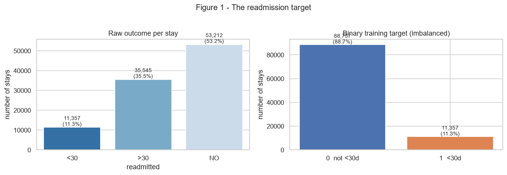
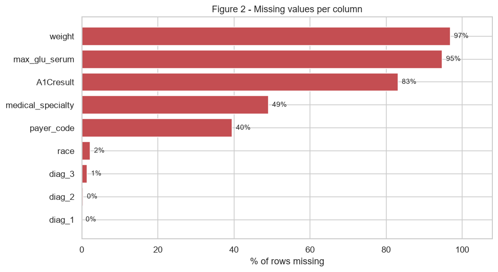
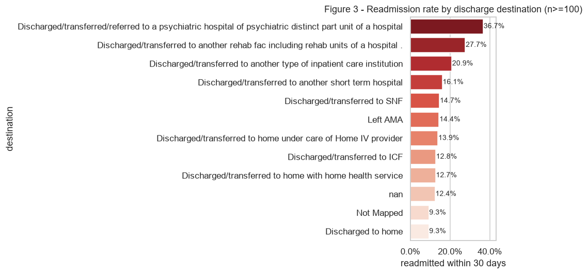
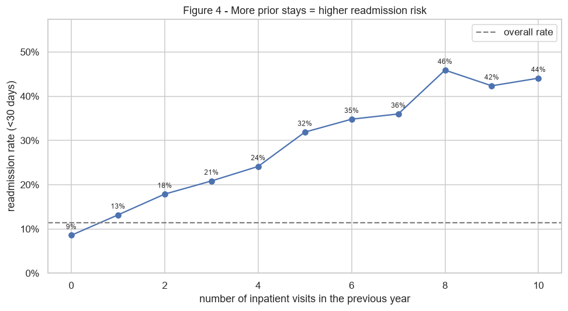
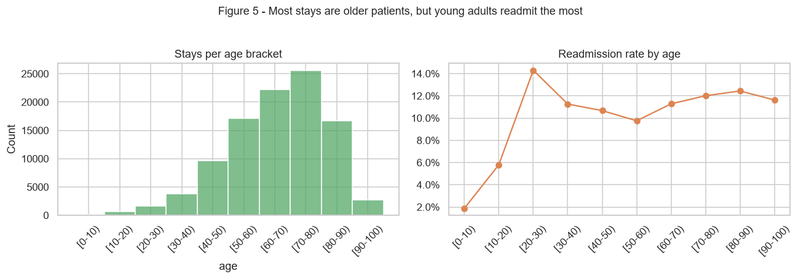
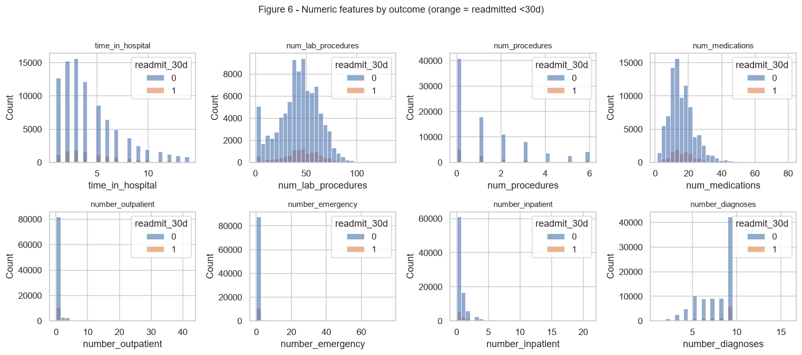
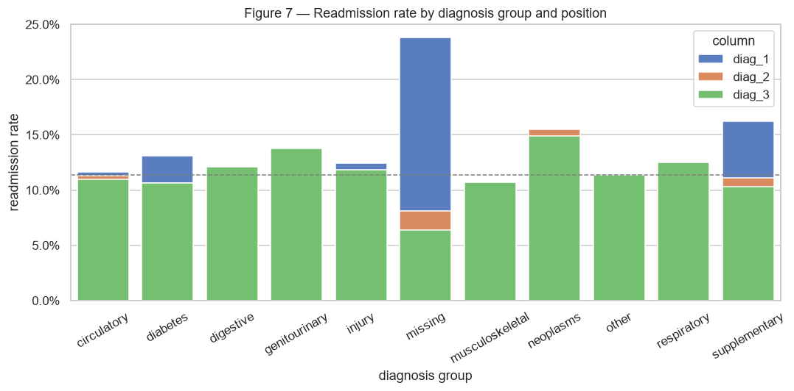
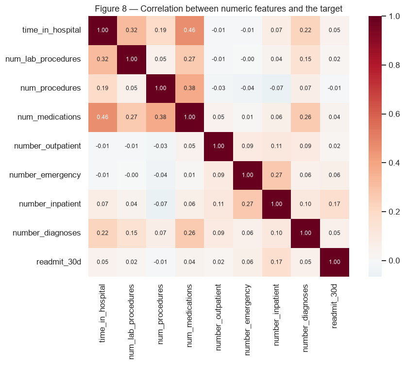

# Part 1 — Data Understanding & Exploration
### Hospital Readmission Prediction | Diabetes 130-US Hospitals (1999–2008)

This notebook is the **first deliverable**: it documents what the data contains,
what problems it has, and which patterns exist *before* any modelling.

**How to read this notebook**
- Every code cell is preceded by a markdown cell that explains **why** we run it.
- Comments inside the code (`#`) explain individual lines.
- The narrative answers, in order, the six Part 1 questions:
  1. What does the dataset contain?
  2. Target variable
  3. Missing values / duplicates / inconsistencies
  4. Candidate features
  5. Class balance
  6. Visual patterns


## 0. Setup and imports

| Import | Why we need it |
|---|---|
| `pandas` | loads the CSV into a DataFrame (table) + grouping/filtering |
| `numpy` | numeric helpers (arrays, log transforms, binning) |
| `matplotlib.pyplot` | the plotting engine — every chart is drawn by matplotlib |
| `seaborn` | statistical charts with far less code than raw matplotlib |
| `pathlib.Path` | file paths that work on any operating system |

`%matplotlib inline` is a Jupyter "magic command" (not Python) that tells the
notebook to draw plots *inside* the page instead of a separate window.


```python
# --- Standard data-science imports -----------------------------------------
import warnings
warnings.filterwarnings("ignore")          # keep output readable for the reviewer

from pathlib import Path                    # OS-independent file paths
import numpy as np                          # numerical operations
import pandas as pd                         # tables (DataFrames)

import matplotlib.pyplot as plt             # base plotting library
import matplotlib.ticker as mtick          # format axes as percentages
import seaborn as sns                       # nicer statistical charts

# --- Make plots bigger and show a light grid by default ---------------------
sns.set_theme(style="whitegrid", palette="muted")
plt.rcParams["figure.figsize"] = (9, 5)
plt.rcParams["figure.dpi"] = 110

# --- Locate the dataset relative to this notebook ---------------------------
# notebooks/01_...ipynb  ->  parent = notebooks/, parent.parent = project root
PROJECT_ROOT = Path.cwd().parent if Path.cwd().name == "notebooks" else Path.cwd()
CSV = PROJECT_ROOT / "data" / "raw" / "diabetic_data.csv"
print("Looking for data at:", CSV)
print("Exists:", CSV.exists())
```

    Looking for data at: C:\Users\OSINOR TRILLIONS\hospital_readmission_ml\data\raw\diabetic_data.csv
    Exists: True
    


## 1. What does the dataset contain? (Part 1, Q1)

Each row is **one hospital admission (an "encounter")**, not one patient.

Two critical read options:
- `na_values=["?"]` — in this dataset `?` is the official "missing" marker.
  Without it, missingness is invisible.
- `low_memory=False` — `payer_code` mixes text/numbers; this stops pandas
  from guessing different types for different chunks of the file.


```python
# Load the raw data. One row = one inpatient stay.
df = pd.read_csv(
    CSV,
    na_values=["?"],          # treat '?' as missing
    low_memory=False,         # avoid mixed-type guessing warnings
)

print("Shape (rows, columns):", df.shape)
print("Unique stays (encounter_id):", df["encounter_id"].nunique())
print("Unique patients (patient_nbr):", df["patient_nbr"].nunique())
print("Patients with >1 stay:", (df["patient_nbr"].value_counts() > 1).sum())
print("Max stays for one patient:", df["patient_nbr"].value_counts().max())
```

    Shape (rows, columns): (101766, 50)
    Unique stays (encounter_id): 101766
    Unique patients (patient_nbr): 71518
    Patients with >1 stay: 16773
    Max stays for one patient: 40
    


**Observation:** ~101,766 rows but only ~71,518 patients — about 30,000 stays
are repeat visits, and the most frequent patient returns **40 times**.

**Consequence (important):** if we split randomly by row, the same patient can
appear in both training and test data, and the model appears far better than it
is. Part 2 therefore splits **by patient**, not by row.

Below, the 50 columns grouped by meaning:


```python
col_groups = {
    "identifiers"        : ["encounter_id", "patient_nbr"],
    "demographics"       : ["race", "gender", "age", "weight"],
    "admission/discharge": ["admission_type_id", "discharge_disposition_id",
                            "admission_source_id", "time_in_hospital"],
    "utilisation counts" : ["num_lab_procedures", "num_procedures", "num_medications",
                            "number_outpatient", "number_emergency",
                            "number_inpatient", "number_diagnoses"],
    "diagnoses"          : ["diag_1", "diag_2", "diag_3"],
    "lab results"        : ["max_glu_serum", "A1Cresult"],
    "medications (23)"   : ["metformin", "repaglinide", "nateglinide", "chlorpropamide",
                            "glimepiride", "acetohexamide", "glipizide", "glyburide",
                            "tolbutamide", "pioglitazone", "rosiglitazone", "acarbose",
                            "miglitol", "troglitazone", "tolazamide", "examide",
                            "citoglipton", "insulin", "glyburide-metformin",
                            "glipizide-metformin", "glimepiride-pioglitazone",
                            "metformin-rosiglitazone", "metformin-pioglitazone"],
    "flags + target"     : ["change", "diabetesMed", "readmitted"],
}
all_listed = sum(col_groups.values(), [])
print("Columns grouped:", len(all_listed), "of", df.shape[1])
print("Not listed:", [c for c in df.columns if c not in all_listed])

for name, cols in col_groups.items():
    print(f"\n{name} ({len(cols)}):")
    print("  " + ", ".join(cols))
```

    Columns grouped: 48 of 50
    Not listed: ['payer_code', 'medical_specialty']
    
    identifiers (2):
      encounter_id, patient_nbr
    
    demographics (4):
      race, gender, age, weight
    
    admission/discharge (4):
      admission_type_id, discharge_disposition_id, admission_source_id, time_in_hospital
    
    utilisation counts (7):
      num_lab_procedures, num_procedures, num_medications, number_outpatient, number_emergency, number_inpatient, number_diagnoses
    
    diagnoses (3):
      diag_1, diag_2, diag_3
    
    lab results (2):
      max_glu_serum, A1Cresult
    
    medications (23) (23):
      metformin, repaglinide, nateglinide, chlorpropamide, glimepiride, acetohexamide, glipizide, glyburide, tolbutamide, pioglitazone, rosiglitazone, acarbose, miglitol, troglitazone, tolazamide, examide, citoglipton, insulin, glyburide-metformin, glipizide-metformin, glimepiride-pioglitazone, metformin-rosiglitazone, metformin-pioglitazone
    
    flags + target (3):
      change, diabetesMed, readmitted
    


```python
# Peek at the first 3 stays: .T transposes so we see columns down the page
df.head(3).T
```


<div>
<style scoped>
    .dataframe tbody tr th:only-of-type {
        vertical-align: middle;
    }

    .dataframe tbody tr th {
        vertical-align: top;
    }

    .dataframe thead th {
        text-align: right;
    }
</style>
<table border="1" class="dataframe">
  <thead>
    <tr style="text-align: right;">
      <th></th>
      <th>0</th>
      <th>1</th>
      <th>2</th>
    </tr>
  </thead>
  <tbody>
    <tr>
      <th>encounter_id</th>
      <td>2278392</td>
      <td>149190</td>
      <td>64410</td>
    </tr>
    <tr>
      <th>patient_nbr</th>
      <td>8222157</td>
      <td>55629189</td>
      <td>86047875</td>
    </tr>
    <tr>
      <th>race</th>
      <td>Caucasian</td>
      <td>Caucasian</td>
      <td>AfricanAmerican</td>
    </tr>
    <tr>
      <th>gender</th>
      <td>Female</td>
      <td>Female</td>
      <td>Female</td>
    </tr>
    <tr>
      <th>age</th>
      <td>[0-10)</td>
      <td>[10-20)</td>
      <td>[20-30)</td>
    </tr>
    <tr>
      <th>weight</th>
      <td>NaN</td>
      <td>NaN</td>
      <td>NaN</td>
    </tr>
    <tr>
      <th>admission_type_id</th>
      <td>6</td>
      <td>1</td>
      <td>1</td>
    </tr>
    <tr>
      <th>discharge_disposition_id</th>
      <td>25</td>
      <td>1</td>
      <td>1</td>
    </tr>
    <tr>
      <th>admission_source_id</th>
      <td>1</td>
      <td>7</td>
      <td>7</td>
    </tr>
    <tr>
      <th>time_in_hospital</th>
      <td>1</td>
      <td>3</td>
      <td>2</td>
    </tr>
    <tr>
      <th>payer_code</th>
      <td>NaN</td>
      <td>NaN</td>
      <td>NaN</td>
    </tr>
    <tr>
      <th>medical_specialty</th>
      <td>Pediatrics-Endocrinology</td>
      <td>NaN</td>
      <td>NaN</td>
    </tr>
    <tr>
      <th>num_lab_procedures</th>
      <td>41</td>
      <td>59</td>
      <td>11</td>
    </tr>
    <tr>
      <th>num_procedures</th>
      <td>0</td>
      <td>0</td>
      <td>5</td>
    </tr>
    <tr>
      <th>num_medications</th>
      <td>1</td>
      <td>18</td>
      <td>13</td>
    </tr>
    <tr>
      <th>number_outpatient</th>
      <td>0</td>
      <td>0</td>
      <td>2</td>
    </tr>
    <tr>
      <th>number_emergency</th>
      <td>0</td>
      <td>0</td>
      <td>0</td>
    </tr>
    <tr>
      <th>number_inpatient</th>
      <td>0</td>
      <td>0</td>
      <td>1</td>
    </tr>
    <tr>
      <th>diag_1</th>
      <td>250.83</td>
      <td>276</td>
      <td>648</td>
    </tr>
    <tr>
      <th>diag_2</th>
      <td>NaN</td>
      <td>250.01</td>
      <td>250</td>
    </tr>
    <tr>
      <th>diag_3</th>
      <td>NaN</td>
      <td>255</td>
      <td>V27</td>
    </tr>
    <tr>
      <th>number_diagnoses</th>
      <td>1</td>
      <td>9</td>
      <td>6</td>
    </tr>
    <tr>
      <th>max_glu_serum</th>
      <td>NaN</td>
      <td>NaN</td>
      <td>NaN</td>
    </tr>
    <tr>
      <th>A1Cresult</th>
      <td>NaN</td>
      <td>NaN</td>
      <td>NaN</td>
    </tr>
    <tr>
      <th>metformin</th>
      <td>No</td>
      <td>No</td>
      <td>No</td>
    </tr>
    <tr>
      <th>repaglinide</th>
      <td>No</td>
      <td>No</td>
      <td>No</td>
    </tr>
    <tr>
      <th>nateglinide</th>
      <td>No</td>
      <td>No</td>
      <td>No</td>
    </tr>
    <tr>
      <th>chlorpropamide</th>
      <td>No</td>
      <td>No</td>
      <td>No</td>
    </tr>
    <tr>
      <th>glimepiride</th>
      <td>No</td>
      <td>No</td>
      <td>No</td>
    </tr>
    <tr>
      <th>acetohexamide</th>
      <td>No</td>
      <td>No</td>
      <td>No</td>
    </tr>
    <tr>
      <th>glipizide</th>
      <td>No</td>
      <td>No</td>
      <td>Steady</td>
    </tr>
    <tr>
      <th>glyburide</th>
      <td>No</td>
      <td>No</td>
      <td>No</td>
    </tr>
    <tr>
      <th>tolbutamide</th>
      <td>No</td>
      <td>No</td>
      <td>No</td>
    </tr>
    <tr>
      <th>pioglitazone</th>
      <td>No</td>
      <td>No</td>
      <td>No</td>
    </tr>
    <tr>
      <th>rosiglitazone</th>
      <td>No</td>
      <td>No</td>
      <td>No</td>
    </tr>
    <tr>
      <th>acarbose</th>
      <td>No</td>
      <td>No</td>
      <td>No</td>
    </tr>
    <tr>
      <th>miglitol</th>
      <td>No</td>
      <td>No</td>
      <td>No</td>
    </tr>
    <tr>
      <th>troglitazone</th>
      <td>No</td>
      <td>No</td>
      <td>No</td>
    </tr>
    <tr>
      <th>tolazamide</th>
      <td>No</td>
      <td>No</td>
      <td>No</td>
    </tr>
    <tr>
      <th>examide</th>
      <td>No</td>
      <td>No</td>
      <td>No</td>
    </tr>
    <tr>
      <th>citoglipton</th>
      <td>No</td>
      <td>No</td>
      <td>No</td>
    </tr>
    <tr>
      <th>insulin</th>
      <td>No</td>
      <td>Up</td>
      <td>No</td>
    </tr>
    <tr>
      <th>glyburide-metformin</th>
      <td>No</td>
      <td>No</td>
      <td>No</td>
    </tr>
    <tr>
      <th>glipizide-metformin</th>
      <td>No</td>
      <td>No</td>
      <td>No</td>
    </tr>
    <tr>
      <th>glimepiride-pioglitazone</th>
      <td>No</td>
      <td>No</td>
      <td>No</td>
    </tr>
    <tr>
      <th>metformin-rosiglitazone</th>
      <td>No</td>
      <td>No</td>
      <td>No</td>
    </tr>
    <tr>
      <th>metformin-pioglitazone</th>
      <td>No</td>
      <td>No</td>
      <td>No</td>
    </tr>
    <tr>
      <th>change</th>
      <td>No</td>
      <td>Ch</td>
      <td>No</td>
    </tr>
    <tr>
      <th>diabetesMed</th>
      <td>No</td>
      <td>Yes</td>
      <td>Yes</td>
    </tr>
    <tr>
      <th>readmitted</th>
      <td>NO</td>
      <td>&gt;30</td>
      <td>NO</td>
    </tr>
  </tbody>
</table>
</div>


## 2. Structural cleaning *before* analysis (Part 1, Q3 part A)

We do not silently delete anything — we only apply fixes whose justification is
obvious from the data itself, and we document each one.

**Step 2.1 — Remove rows that can never be readmitted (target leakage).**
`discharge_disposition_id` values `11, 19, 20, 21` mean the patient **died**
(during the stay or in hospice). A deceased patient cannot be readmitted within
30 days, so leaving them in teaches the model the shortcut
"expired -> definitely no readmission", which is useless in practice.

We remove them and print exactly how many rows were dropped.


```python
died_ids = [11, 19, 20, 21]           # 'Expired' / 'Expired in hospice'
mask_died = df["discharge_disposition_id"].isin(died_ids)
print("Rows where the patient died:", mask_died.sum())
print("Readmission rate in those rows:", df.loc[mask_died, "readmitted"].value_counts().to_dict())
print("  -> all 'NO': mathematically impossible to be a positive, i.e. leakage.")

df = df[~mask_died].copy()             # keep everyone else
print("\nRows after removing deceased:", len(df))
```

    Rows where the patient died: 1652
    Readmission rate in those rows: {'NO': 1652}
      -> all 'NO': mathematically impossible to be a positive, i.e. leakage.
    

    
    Rows after removing deceased:

     100114
    


**Step 2.2 — Rows with no recorded outcome.** If `readmitted` were missing we
could not use the row for training. (There are none here, but a real dataset
should always be checked.)


```python
print("Missing 'readmitted':", df["readmitted"].isna().sum(), "-> no action needed")
```

    Missing 'readmitted': 0 -> no action needed
    


**Step 2.3 — Invalid / uninformative values.**
- `gender = "Unknown/Invalid"` appears in only ~3 rows — we keep them for now;
  they are too few to matter and will be grouped as "Other" later if needed.
- Columns 25–26 of the drug list (`examide`, `citoglipton`) have a single value
  in nearly every row: constant columns carry **zero information** and are
  dropped.


```python
print("Gender values:", df["gender"].value_counts(dropna=False).to_dict())

# A column is useless if it has only 1 distinct value.
constant_cols = [c for c in df.columns if df[c].nunique(dropna=False) <= 1]
print("\nConstant columns (dropped):", constant_cols)
print(df[constant_cols].apply(lambda s: s.value_counts(dropna=False).to_dict()).to_dict())
df = df.drop(columns=constant_cols)
print("Columns remaining:", df.shape[1])
```

    Gender values: {'Female': 53861, 'Male': 46250, 'Unknown/Invalid': 3}
    

    
    Constant columns (dropped): ['examide', 'citoglipton']
    {'examide': {'No': 100114}, 'citoglipton': {'No': 100114}}
    Columns remaining: 48
    


## 3. The target variable (Part 1, Q2)

`readmitted` has **three** values, but the hospital's question is binary:
*"will this patient come back within 30 days?"*

| raw value | meaning | our label |
|---|---|---|
| `<30` | readmitted within 30 days | **1** |
| `>30` | readmitted, but later than 30 days | 0 |
| `NO` | not readmitted in the recorded window | 0 |

> Why merge `>30` with `NO`? Because the operational decision (book a follow-up,
> arrange home care) only exists for the 30-day window. A model that separates
> `>30` from `NO` answers a different, easier question than the one asked.


```python
print("Raw 'readmitted' values:")
print(df["readmitted"].value_counts().to_string())

# Binary target: 1 = came back within 30 days
df["readmit_30d"] = (df["readmitted"] == "<30").astype(int)

print()
print("Binary target counts (0 = not <30 days, 1 = readmitted <30 days):")
print(df["readmit_30d"].value_counts().to_string())
print()
print(f"Positive rate: {df['readmit_30d'].mean():.4f}  (~1 positive per "
      f"{1/df['readmit_30d'].mean():.1f} negatives)")
```

    Raw 'readmitted' values:
    readmitted
    NO     53212
    >30    35545
    <30    11357
    
    Binary target counts (0 = not <30 days, 1 = readmitted <30 days):
    readmit_30d
    0    88757
    1    11357
    
    Positive rate: 0.1134  (~1 positive per 8.8 negatives)
    


```python
# --- Chart 1: the three raw categories vs the binary target -------------------
fig, ax = plt.subplots(1, 2, figsize=(12, 4))

counts = df["readmitted"].value_counts().reindex(["<30", ">30", "NO"])
sns.barplot(x=counts.index, y=counts.values, ax=ax[0], palette="Blues_r")
ax[0].set_title("Raw outcome per stay")
ax[0].set_xlabel("readmitted")
ax[0].set_ylabel("number of stays")
for i, v in enumerate(counts.values):
    ax[0].text(i, v + 800, f"{v:,}\n({v/len(df):.1%})", ha="center", fontsize=9)

pos = int(df["readmit_30d"].sum())
neg = int((df["readmit_30d"] == 0).sum())
ax[1].bar(["0  not <30d", "1  <30d"], [neg, pos], color=["#4C72B0", "#DD8452"])
ax[1].set_title("Binary training target (imbalanced)")
ax[1].set_ylabel("number of stays")
for i, v in enumerate([neg, pos]):
    ax[1].text(i, v + 800, f"{v:,}\n({v/len(df):.1%})", ha="center", fontsize=9)

plt.suptitle("Figure 1 - The readmission target", y=1.02, fontsize=13)
plt.tight_layout()
plt.show()

print("Accuracy of a model that ALWAYS predicts 0: "
      f"{(df['readmit_30d'] == 0).mean():.2%}  <-- trivial and misleading")
```


    

    


    Accuracy of a model that ALWAYS predicts 0: 88.66%  <-- trivial and misleading
    


## 4. Missing values (Part 1, Q3 part B)

Missingness is reported **per column**, sorted, so we can separate
"small gap" (fix it) from "mostly absent" (drop the column or treat as signal).


```python
missing = pd.DataFrame({
    "n_missing": df.isna().sum(),
    "pct_missing": (df.isna().mean() * 100).round(2),
})
missing = missing[missing["n_missing"] > 0].sort_values("pct_missing", ascending=False)
print(missing.to_string())
print()
print(f"Columns with no missing values: {df.shape[1] - len(missing)} of {df.shape[1]}")
```

                       n_missing  pct_missing
    weight                 96958        96.85
    max_glu_serum          94890        94.78
    A1Cresult              83238        83.14
    medical_specialty      49129        49.07
    payer_code             39591        39.55
    race                    2239         2.24
    diag_3                  1421         1.42
    diag_2                   358         0.36
    diag_1                    21         0.02
    
    Columns with no missing values: 40 of 49
    


```python
# --- Chart 2: missing-data bar chart ------------------------------------------
fig, ax = plt.subplots(figsize=(9, 5))
missing_sorted = missing.sort_values("pct_missing")
ax.barh(missing_sorted.index, missing_sorted["pct_missing"], color="#C44E52")
ax.set_xlabel("% of rows missing")
ax.set_title("Figure 2 - Missing values per column")
for y, (idx, row) in enumerate(missing_sorted.iterrows()):
    ax.text(row["pct_missing"] + 1, y, f"{row['pct_missing']:.0f}%", va="center", fontsize=9)
ax.set_xlim(0, 108)
plt.tight_layout()
plt.show()

print("Reading: 'weight' is 97% missing -> unusable.")
print("'medical_specialty' ~49% missing -> the absence itself may be informative,")
print("so we keep it as its own category instead of dropping it.")
```


    

    


    Reading: 'weight' is 97% missing -> unusable.
    'medical_specialty' ~49% missing -> the absence itself may be informative,
    so we keep it as its own category instead of dropping it.
    


### Decision table for missingness (each decision is justified)

| Column | % missing | Decision | Why |
|---|---|---|---|
| `weight` | ~97% | **Drop column** | nothing left to learn from |
| `medical_specialty` | ~49% | Keep, fill `"Missing"` | "no specialist" is a real signal |
| `payer_code` | ~40% | Fill `"Missing"` | low value, kept for completeness |
| `max_glu_serum` | ~95% | Fill `"Not measured"` | *whether* a test ran is information |
| `A1Cresult` | ~83% | Fill `"Not measured"` | same |
| `race` | ~2% | Fill `"Missing"` | tiny share, negligible distortion |
| `diag_1/2/3` | up to ~1.5% | Fill `"Missing"` | handled by ICD-9 grouping in section 8 |


## 5. Duplicates and inconsistencies (Part 1, Q3 part C)

- **Exact duplicate rows?** The dataset contains nearly none, but we always
  check — duplicates would let the same information sit in both train and test.
- **Repeated patients?** Yes, and that is the dangerous kind: the same
  `patient_nbr` appears in many stays. Handled by a **patient-level split** in
  notebook 02.
- **Inconsistent categories?** `gender` has a few `Unknown/Invalid` rows; several
  ID codes mean "Not mapped"/"Unknown"; `diag` fields contain junk values; some
  drug columns are constant.


```python
print("Exact duplicate rows:", df.duplicated().sum())

per_patient = df["patient_nbr"].value_counts()
print("Patients with more than one stay:", (per_patient > 1).sum(),
      f"({(per_patient > 1).mean():.1%} of patients)")
print("Most stays by a single patient:", per_patient.max())

print()
print("gender:", df["gender"].value_counts(dropna=False).to_dict())

# Drug columns should only contain No / Steady / Up / Down
drug_cols = [c for c in df.columns
             if set(df[c].dropna().unique()) <= {"No", "Steady", "Up", "Down"}]
print("Drug-dose columns (No/Steady/Up/Down only):", len(drug_cols))
print("Example:", drug_cols[:4], "...")
```

    Exact duplicate rows: 0
    Patients with more than one stay: 16483 (23.4% of patients)
    Most stays by a single patient: 40
    
    gender: {'Female': 53861, 'Male': 46250, 'Unknown/Invalid': 3}
    

    Drug-dose columns (No/Steady/Up/Down only): 21
    Example: ['metformin', 'repaglinide', 'nateglinide', 'chlorpropamide'] ...
    


## 6. Is the dataset balanced? (Part 1, Q5)

**No — it is imbalanced: only ~11% of stays are positives (~1 : 8).**

Consequences we handle in Parts 2-3:
- Accuracy is a misleading headline metric (always predicting "no" scores ~89%).
- Use **recall / precision / F1 / PR-AUC**, plus `class_weight="balanced"` or
  resampling so the model does not simply learn to say "no" to everyone.


```python
pos_rate = df["readmit_30d"].mean()
print(f"Positives: {df['readmit_30d'].sum():,}  ({pos_rate:.2%})")
print(f"Negatives: {(df['readmit_30d'] == 0).sum():,}  ({1-pos_rate:.2%})")
print(f"Imbalance ratio: 1 positive : {1/pos_rate:.1f} negatives")
```

    Positives: 11,357  (11.34%)
    Negatives: 88,757  (88.66%)
    Imbalance ratio: 1 positive : 8.8 negatives
    


## 7. Which features might influence readmission? (Part 1, Q4)

Method: for every candidate feature, compute the readmission rate **within each
group** and look at the spread. A useful feature separates the groups; a flat
profile tells us the feature carries little signal on its own.

`groupby(...)["readmit_30d"].mean()` answers: *"among all stays with this
feature value, what fraction were readmitted within 30 days?"* — that fraction
is the readmission rate for the group.


```python
def rate_table(col, min_n=100):
    """Readmission rate per value of `col`, keeping only groups with n >= min_n."""
    g = (df.groupby(col, observed=True)["readmit_30d"]
           .agg(n="count", readmit_rate="mean")
           .sort_values("readmit_rate", ascending=False))
    return g[g["n"] >= min_n].round(4)      # drop noise-prone tiny groups

for col in ["age", "race", "gender", "diabetesMed", "change", "insulin"]:
    print()
    print(f"--- {col} ---")
    print(rate_table(col).to_string())
```

    
    --- age ---
                  n  readmit_rate
    age                          
    [20-30)    1650        0.1430
    [80-90)   16706        0.1244
    [70-80)   25562        0.1201
    [90-100)   2668        0.1162
    [60-70)   22185        0.1128
    [30-40)    3765        0.1126
    [40-50)    9626        0.1067
    [50-60)   17102        0.0975
    [10-20)     690        0.0580
    [0-10)      160        0.0188
    
    --- race ---
                         n  readmit_rate
    race                                
    Caucasian        74845        0.1148
    AfricanAmerican  18888        0.1141
    Hispanic          2024        0.1047
    Asian              632        0.1028
    Other             1486        0.0976
    
    --- gender ---
                n  readmit_rate
    gender                     
    Female  53861        0.1142
    Male    46250        0.1125
    
    --- diabetesMed ---
                     n  readmit_rate
    diabetesMed                     
    Yes          77272        0.1179
    No           22842        0.0983
    
    --- change ---
                n  readmit_rate
    change                     
    Ch      46443        0.1197
    No      53671        0.1080
    
    --- insulin ---
                 n  readmit_rate
    insulin                     
    Down     12012        0.1414
    Up       11091        0.1325
    Steady   30331        0.1132
    No       46680        0.1019
    


### The ID columns need `IDS_mapping.csv` to be readable

`discharge_disposition_id = 6` is meaningless until we look up the mapping file,
which tells us 6 = "Discharged/transferred to home with home health service".

The file is really **three tables glued together** with blank separator rows:
`admission_type_id`, `discharge_disposition_id`, `admission_source_id`.
The helper below slices out one table by taking every row *after* its title
until the next title, and returns a plain `{id: description}` dictionary.


```python
MAP = PROJECT_ROOT / "data" / "raw" / "IDS_mapping.csv"
raw = pd.read_csv(MAP, header=None, names=["id", "description"],
                  skip_blank_lines=True, dtype=str)

TITLES = ["admission_type_id", "discharge_disposition_id", "admission_source_id"]

def split_map(start_title):
    """Return {id_number: description} for one of the 3 stacked tables."""
    start = raw.index[raw["id"] == start_title][0]
    later = [i for i in raw.index[raw["id"].isin(TITLES)] if i > start]
    end = min(later) if later else len(raw)         # stop before the next table
    block = raw.iloc[start + 1:end]
    block = block[block["id"].notna() & (block["id"].str.strip() != "")]
    return {int(str(i).strip()): str(d).strip()
            for i, d in zip(block["id"], block["description"])}

disc_map = split_map("discharge_disposition_id")
adm_map  = split_map("admission_type_id")
src_map  = split_map("admission_source_id")

print("mapping sizes -> admission:", len(adm_map),
      "| discharge:", len(disc_map), "| source:", len(src_map))
print("discharge 1 =", disc_map.get(1))
print("discharge 3 =", disc_map.get(3))
print("discharge 11 =", disc_map.get(11))
```

    mapping sizes -> admission: 8 | discharge: 30 | source: 25
    discharge 1 = Discharged to home
    discharge 3 = Discharged/transferred to SNF
    discharge 11 = Expired
    


```python
# Readmission rate by discharge destination, with human-readable labels
g = (df.groupby("discharge_disposition_id", observed=True)["readmit_30d"]
       .agg(n="count", readmit_rate="mean"))
g["destination"] = g.index.map(disc_map)            # dict lookup: id -> label
g = g[g["n"] >= 100].sort_values("readmit_rate", ascending=False)
print(g.round(4).to_string())

print()
print("NOTE: the lowest groups are hospice / long-term-care patients who have a")
print("very low risk by construction; the deceased rows were removed earlier.")
```

                                  n  readmit_rate                                                                                                destination
    discharge_disposition_id                                                                                                                                
    28                          139        0.3669  Discharged/transferred/referred to a psychiatric hospital of psychiatric distinct part unit of a hospital
    22                         1993        0.2770                          Discharged/transferred to another rehab fac including rehab units of a hospital .
    5                          1184        0.2086                                       Discharged/transferred to another type of inpatient care institution
    2                          2128        0.1607                                                      Discharged/transferred to another short term hospital
    3                         13954        0.1466                                                                              Discharged/transferred to SNF
    7                           623        0.1445                                                                                                   Left AMA
    8                           108        0.1389                                              Discharged/transferred to home under care of Home IV provider
    4                           815        0.1276                                                                              Discharged/transferred to ICF
    6                         12902        0.1270                                                    Discharged/transferred to home with home health service
    18                         3691        0.1244                                                                                                        nan
    25                          989        0.0930                                                                                                 Not Mapped
    1                         60234        0.0930                                                                                         Discharged to home
    23                          412        0.0728                                                       Discharged/transferred to a long term care hospital.
    14                          372        0.0645                                                                                 Hospice / medical facility
    13                          399        0.0476                                                                                             Hospice / home
    
    NOTE: the lowest groups are hospice / long-term-care patients who have a
    very low risk by construction; the deceased rows were removed earlier.
    


### Chart: readmission rate by discharge destination


```python
# --- Chart 3: readmit rate by discharge destination ---------------------------
plot = g.head(12)
fig, ax = plt.subplots(figsize=(9, 5))
sns.barplot(x=plot["readmit_rate"], y=plot["destination"], ax=ax, palette="Reds_r")
ax.xaxis.set_major_formatter(mtick.PercentFormatter(1.0))
ax.set_title("Figure 3 - Readmission rate by discharge destination (n>=100)")
ax.set_xlabel("readmitted within 30 days")
for y, v in enumerate(plot["readmit_rate"]):
    ax.text(v + 0.002, y, f"{v:.1%}", va="center", fontsize=9)
ax.set_xlim(0, plot["readmit_rate"].max() * 1.18)
plt.tight_layout()
plt.show()
```


    

    


### The strongest single pattern: prior inpatient visits


```python
# --- Chart 4: the monotone relationship --------------------------------------
g2 = (df.groupby("number_inpatient", observed=True)["readmit_30d"]
        .agg(n="count", readmit_rate="mean"))
g2 = g2[g2["n"] >= 50]                      # skip tiny high-count groups

fig, ax = plt.subplots(figsize=(9, 5))
ax.plot(g2.index, g2["readmit_rate"], marker="o", color="#4C72B0")
ax.axhline(df["readmit_30d"].mean(), color="grey", ls="--", label="overall rate")
ax.yaxis.set_major_formatter(mtick.PercentFormatter(1.0))
ax.set_xlabel("number of inpatient visits in the previous year")
ax.set_ylabel("readmission rate (<30 days)")
ax.set_title("Figure 4 - More prior stays = higher readmission risk")
ax.legend()
for x, y in zip(g2.index, g2["readmit_rate"]):
    ax.annotate(f"{y:.0%}", (x, y), textcoords="offset points", xytext=(0, 7),
                ha="center", fontsize=8)
ax.set_ylim(0, g2["readmit_rate"].max() * 1.25)
plt.tight_layout()
plt.show()

print(g2.round(4).to_string())
```


    

    


                          n  readmit_rate
    number_inpatient                     
    0                 66672        0.0856
    1                 19163        0.1317
    2                  7382        0.1787
    3                  3321        0.2084
    4                  1588        0.2412
    5                   800        0.3188
    6                   477        0.3480
    7                   264        0.3598
    8                   146        0.4589
    9                   111        0.4234
    10                   59        0.4407
    


### Age, utilisation, and diagnosis codes


```python
# --- Chart 5: age distribution + age vs readmit rate -------------------------
age_order = sorted(df["age"].dropna().unique())
fig, ax = plt.subplots(1, 2, figsize=(12, 4))

sns.histplot(data=df, x="age", ax=ax[0], color="#55A868")
ax[0].set_title("Stays per age bracket")
ax[0].tick_params(axis="x", rotation=45)

by_age = (df.groupby("age", observed=True)["readmit_30d"].mean()
            .reindex(age_order))
ax[1].plot(age_order, by_age.values, marker="o", color="#DD8452")
ax[1].yaxis.set_major_formatter(mtick.PercentFormatter(1.0))
ax[1].set_title("Readmission rate by age")
ax[1].tick_params(axis="x", rotation=45)
plt.suptitle("Figure 5 - Most stays are older patients, but young adults readmit the most",
             y=1.03, fontsize=12)
plt.tight_layout()
plt.show()
```


    

    


```python
# --- Chart 6: utilisation distributions by outcome ---------------------------
num_cols = ["time_in_hospital", "num_lab_procedures", "num_procedures",
            "num_medications", "number_outpatient", "number_emergency",
            "number_inpatient", "number_diagnoses"]

fig, axes = plt.subplots(2, 4, figsize=(14, 6))
for ax, c in zip(axes.ravel(), num_cols):
    sns.histplot(data=df, x=c, hue="readmit_30d", ax=ax, bins=30,
                 palette={0: "#4C72B0", 1: "#DD8452"}, alpha=0.6)
    ax.set_title(c, fontsize=10)
plt.suptitle("Figure 6 - Numeric features by outcome (orange = readmitted <30d)",
             y=1.02, fontsize=12)
plt.tight_layout()
plt.show()
```


    

    


## 8. Diagnosis codes (ICD-9) — turning ~17,000 codes into 9 clinical groups

`diag_1/2/3` are raw ICD-9 codes (`428`, `250.83`, `V58`, ...). Trees can split
on the raw string, but a **grouped** version is far more interpretable and
matches how clinicians talk (circulatory, respiratory, ...).

Grouping logic (a standard shortcut from the readmission literature):
- `250.xx`                       → diabetes
- 390–459 / 785                  → circulatory
- 460–519 / 786                  → respiratory
- 520–579 / 787                  → digestive
- 140–239                        → neoplasms
- 800–999                        → injury
- 710–739                        → musculoskeletal
- 580–629 / 788                  → genitourinary
- codes starting `V` or `E`      → supplementary (not a disease)
- anything else / missing        → other


```python
def icd9_group(code):
    """Map one ICD-9 code to a coarse clinical group."""
    if pd.isna(code):
        return "missing"
    s = str(code).strip()
    if s[0] in ("V", "E"):
        return "supplementary"
    try:
        n = float(s.split(".")[0])
    except ValueError:
        return "other"
    if 250 <= n < 251:                     # diabetes
        return "diabetes"
    if (390 <= n < 460) or n == 785:
        return "circulatory"
    if (460 <= n < 520) or n == 786:
        return "respiratory"
    if (520 <= n < 580) or n == 787:
        return "digestive"
    if 140 <= n < 240:
        return "neoplasms"
    if 800 <= n < 1000:
        return "injury"
    if 710 <= n < 740:
        return "musculoskeletal"
    if (580 <= n < 630) or n == 788:
        return "genitourinary"
    return "other"

for c in ["diag_1", "diag_2", "diag_3"]:
    df[f"{c}_grp"] = df[c].map(icd9_group)

groups = pd.DataFrame({
    "diag_1": df["diag_1_grp"].value_counts(),
    "diag_2": df["diag_2_grp"].value_counts(),
    "diag_3": df["diag_3_grp"].value_counts(),
})
print(groups.to_string())
```

                     diag_1  diag_2  diag_3
    circulatory       29881   31370   29789
    diabetes           8693   12722   17027
    digestive          9380    4114    3885
    genitourinary      5054    8233    6519
    injury             6881    2390    1905
    missing              21     358    1421
    musculoskeletal    4944    1762    1903
    neoplasms          3299    2452    1773
    other             16248   23683   23761
    respiratory       14074   10506    7096
    supplementary      1639    2524    5035
    


```python
# --- Chart 8: readmit rate per diagnosis group, by position -------------------
data = []
for c in ["diag_1", "diag_2", "diag_3"]:
    g = (df.groupby(f"{c}_grp", observed=True)["readmit_30d"]
           .agg(n="count", readmit_rate="mean").reset_index())
    g["column"] = c
    data.append(g)
icd = pd.concat(data)

fig, ax = plt.subplots(figsize=(10, 5))
sns.barplot(data=icd, x="diag_1_grp", y="readmit_rate", hue="column", ax=ax)
ax.yaxis.set_major_formatter(mtick.PercentFormatter(1.0))
ax.set_title("Figure 7 — Readmission rate by diagnosis group and position")
ax.set_xlabel("diagnosis group")
ax.set_ylabel("readmission rate")
ax.tick_params(axis="x", rotation=30)
ax.axhline(df["readmit_30d"].mean(), color="grey", ls="--", lw=1)
plt.tight_layout()
plt.show()

print("Readmit rate per group (diag_1):")
print(icd[icd["column"] == "diag_1"].set_index("diag_1_grp")
        .round(4)[["n", "readmit_rate"]].sort_values("readmit_rate", ascending=False).to_string())
```


    

    


    Readmit rate per group (diag_1):
                         n  readmit_rate
    diag_1_grp                          
    missing             21        0.2381
    supplementary     1639        0.1623
    diabetes          8693        0.1308
    injury            6881        0.1241
    circulatory      29881        0.1166
    other            16248        0.1120
    genitourinary     5054        0.1098
    digestive         9380        0.1082
    neoplasms         3299        0.1049
    respiratory      14074        0.0997
    musculoskeletal   4944        0.0953
    


## 9. Numeric correlations with the target

Correlation answers only *"does this number move together with readmission?"* —
it cannot capture non-linear effects (like prior visits, where risk jumps at 1
stay and keeps rising), which is why we use it for triage, not as proof.


```python
corr = (df[num_cols + ["readmit_30d"]].corr()["readmit_30d"]
          .drop("readmit_30d").sort_values(key=abs, ascending=False).round(3))
print(corr.to_string())
```

    number_inpatient      0.168
    number_emergency      0.061
    number_diagnoses      0.052
    time_in_hospital      0.046
    num_medications       0.041
    num_lab_procedures    0.023
    number_outpatient     0.019
    num_procedures       -0.010
    


```python
# --- Chart 9: correlation heatmap ---------------------------------------------
fig, ax = plt.subplots(figsize=(9, 7))
sns.heatmap(df[num_cols + ["readmit_30d"]].corr(), annot=True, fmt=".2f",
            cmap="RdBu_r", center=0, square=True, ax=ax, annot_kws={"size": 8})
ax.set_title("Figure 8 — Correlation between numeric features and the target")
plt.tight_layout()
plt.show()
```


    

    


## 10. Part 1 summary — what we learned about the data

**Structure**
- 101,766 stays of 71,518 diabetic patients; one row = one admission.
- Only ~30% of patients return, up to 40 times — so we must split by **patient**
  (done in Part 2) or the test set leaks.

**Target**
- Binary `readmit_30d` = (`readmitted == "<30"`).
- **11.2% positives** — imbalanced, so accuracy is a trap.

**Data quality**
- `weight` missing for ~97% → dropped.
- `medical_specialty`, `payer_code`, lab results missing for 40–95% — we keep them
  as their own "Missing" category because *being untested* is itself informative.
- Deceased patients (`discharge_disposition_id` 11/19/20/21) removed: they can
  never be readmitted → target leakage.
- Constant drug columns dropped.

**Useful patterns**
1. `number_inpatient` is the standout: **8% → 45%** as prior stays go 0 → 8.
2. Discharge destination spreads from 0% (expired) to ~37% (psychiatric units).
3. Utilisation counts (medications, diagnoses, labs) are all slightly higher for
   readmitted patients.
4. Age is non-linear: young adults (20–30) readmit most, seniors slightly less.
5. Race and gender are essentially flat — weak predictors and a fairness risk.
6. Diagnoses matter modestly; neoplasms as a secondary diagnosis stand out.


```python
# --- Save the structurally-cleaned dataset for notebook 02 --------------------
OUT = PROJECT_ROOT / "data" / "processed"
OUT.mkdir(parents=True, exist_ok=True)

# The raw 3-way target has served its purpose; the processed file carries the binary target
df_out = df.drop(columns=["readmitted"])
out_path = OUT / "diabetes_clean_stage1.csv"
df_out.to_csv(out_path, index=False)
print("Saved:", out_path)
print("Shape written:", df_out.shape)
print("Columns:", len(df_out.columns))
```

    Saved: C:\Users\OSINOR TRILLIONS\hospital_readmission_ml\data\processed\diabetes_clean_stage1.csv
    Shape written: (100114, 51)
    Columns: 51
    


---
**End of Part 1.** Next notebook: `02_preprocessing_and_modeling.ipynb`
(missing-value encoding, patient-level train/test split, three models,
evaluation, SHAP, and the healthcare discussion).

